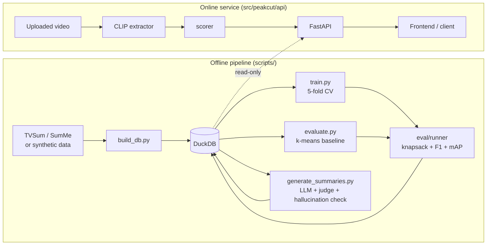
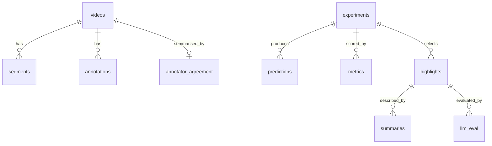

<div align="center">

# ✂️ Peakcut

**Find the best moments in a video, understand why annotators disagree about them, and explain each one in plain text.**


[Overview](#-overview) · [Architecture](#-architecture) · [Quick start](#-quick-start) · [Database](#-database) · [API](#-api-reference) · [Method](#-method-in-detail) · [Testing](#-testing) · [Status](#-project-status-read-this)

</div>

---

## 📖 Overview

Peakcut is a **video highlight detection and summarisation system**. Given a video, it:

1. turns frames into embeddings,
2. scores how "highlight-worthy" each moment is with a temporal transformer,
3. selects the best segments under a length budget (15% of the video by default),
4. asks an LLM to write a **title and short summary** for each highlight, and
5. **measures** how trustworthy those outputs are.

What makes it more than a basic highlight detector:

| Idea | What Peakcut does |
|---|---|
| 🧑‍🤝‍🧑 **Annotators disagree** | Computes inter-annotator agreement per video, flags the low-agreement quartile, and studies how label noise affects the model |
| ⚖️ **Which loss is better?** | Trains the same model with **BCE**, **pairwise ranking**, and **contrastive** losses and compares F1 / mAP |
| 🚫 **Do we even need labels?** | An unsupervised **k-means baseline** runs through the identical evaluation |
| 🧩 **Where does it fail?** | Metrics are broken down **per video category** (subgroup analysis) |
| 🧪 **LLM output is tested, not trusted** | Prompt variants, an LLM-as-judge rubric, and a lexical hallucination check |
| 🔁 **Two frameworks** | The model exists in **PyTorch** and **JAX** with a weight-conversion parity test |
| 🗄️ **Everything is queryable** | Runs, predictions, metrics, highlights and LLM evaluations live in **DuckDB**, analysed with plain SQL |
| 🚀 **It is a service** | FastAPI backend, Docker image, CI, and an automated test suite |

---

## 🏗 Architecture



**Design rules**

- The API opens the database **read-only**. Scripts write; the service only reads, so they never conflict (DuckDB allows one writer).
- Raw videos and embeddings stay **on disk**; the database stores only their paths.
- Every run is stored under a unique `run_id`, so any result in the README can be regenerated and queried.

---

## ✨ Features

- **Data**: loaders for TVSum and SumMe (KTS-style HDF5), plus a seeded **synthetic dataset** so the whole pipeline runs without downloads.
- **Models**: PyTorch temporal transformer · JAX port · unsupervised k-means baseline.
- **Losses**: BCE (with label smoothing) · pairwise hinge ranking · listwise contrastive (InfoNCE).
- **Evaluation**: knapsack summary selection · F1 vs annotator summaries · mAP vs consensus labels · per-category metrics · noise sensitivity.
- **Robustness**: synthetic label-noise injection and a confident-learning-style relabeller.
- **LLM layer**: three prompt variants · judge rubric · hallucination heuristic · pluggable clients (Anthropic, mock).
- **Serving**: 8 endpoints, CORS, read-only DB access, upload scoring path, HTTP range requests for video playback.
- **Engineering**: typed config, Makefile, Dockerfile, GitHub Actions CI, ruff, 60 tests.

---

## 🧰 Tech stack

| Layer | Tools |
|---|---|
| Language | Python 3.10+ |
| Deep learning | PyTorch (primary), JAX + optax (port) |
| Embeddings | CLIP via `transformers` (uploads) |
| Classical ML | scikit-learn (k-means), SciPy, NumPy |
| Database | DuckDB, pandas / pyarrow for bulk loads |
| API | FastAPI, Pydantic v2, Uvicorn |
| LLM | Anthropic API (optional), mock client for offline use |
| Tooling | pytest, ruff, Docker, GitHub Actions |

---

## 🚀 Quick start

No dataset or GPU needed for the first run.

```bash
git clone https://github.com/AARAV-git/peakcut.git
cd peakcut

# 1. Install (pick the extras you need)
pip install -e ".[api,jax,dev]"        # core + API + JAX + tests
# pip install -e ".[train]"            # PyTorch training
# pip install -e ".[features]"         # CLIP extractor (video uploads)
# pip install -e ".[llm]"              # Anthropic client

# 2. Build the database from synthetic data
make db

# 3. Run the unsupervised baseline and see the leaderboard
make baseline

# 4. Train with each loss (needs the "train" extra)
python scripts/train.py --loss bce
python scripts/train.py --loss ranking
python scripts/train.py --loss contrastive

# 5. Generate LLM titles/summaries (offline plumbing demo)
python scripts/generate_summaries.py --mock

# 6. Start the API → http://localhost:8000/docs
make serve

# 7. Run the tests
make test
```

### Using real data

TVSum and SumMe are not bundled and the build environment could not verify any download link, so you supply the files.

```bash
# put these in data/raw/
#   tvsum.h5                  KTS/DSNet-style TVSum file
#   summe.h5                  KTS/DSNet-style SumMe file
#   ydata-tvsum50-info.tsv    optional: gives TVSum categories for subgroup analysis
make data                      # checks which files are present
make db SOURCE=tvsum           # or SOURCE=summe
```

### LLM summaries with a real model

```bash
export ANTHROPIC_API_KEY=...                 # never commit this
# captions: data/captions/<video_id>.json = list with one caption per sampled frame
python scripts/generate_summaries.py --variants captions few_shot
```

---

## 🗂 Project structure

```
peakcut/
├── README.md
├── pyproject.toml            dependencies, extras, pytest + ruff settings
├── Makefile                  shortcuts: db, baseline, train, summaries, test, serve, reproduce
├── Dockerfile                API image (inference only; no training deps)
├── .github/workflows/ci.yml  ruff + pytest (CPU torch) on every push
├── configs/                  default.yaml · loss_{bce,ranking,contrastive}.yaml · api.yaml
├── sql/                      schema + analysis queries
├── scripts/                  command-line entry points
├── src/peakcut/              the package
├── tests/                    pytest suite
├── notebooks/                (for the annotator-disagreement exploration)
└── data/                     gitignored: raw, features, checkpoints, db, media, captions
```

<details>
<summary><b>📄 What every file does (click to expand)</b></summary>

### `sql/`
| File | Purpose |
|---|---|
| `schema.sql` | Creates all tables |
| `annotator_agreement.sql` | Mean pairwise Pearson correlation between annotators per video; flags the bottom quartile per dataset |
| `per_category_metrics.sql` | F1 / mAP averaged per video category for one run |
| `noise_sensitivity.sql` | Metrics vs injected label-noise level, per loss |
| `leaderboard.sql` | All runs ranked by F1 then mAP |

### `scripts/`
| File | Purpose |
|---|---|
| `download_data.py` | Checks that dataset files exist in `data/raw/` and says what is missing |
| `build_db.py` | Builds the DuckDB database from synthetic data, TVSum or SumMe; writes features to disk |
| `extract_features.py` | CLIP embeddings for your own video folder (not wired into TVSum annotations) |
| `train.py` | 5-fold cross-validated PyTorch training; stores predictions, metrics, highlights; `--save-final` writes a checkpoint |
| `evaluate.py` | Runs the k-means baseline and prints the leaderboard |
| `generate_summaries.py` | LLM titles/summaries → judge → hallucination flag → database |

### `src/peakcut/`
| Module | File | Purpose |
|---|---|---|
| core | `config.py` | Typed config loaded from layered YAML; seeding |
| `db/` | `connection.py` | Opens DuckDB (read-write for scripts, **read-only** for the API) |
| | `loader.py` | Creates schema, bulk-loads videos/segments/annotations, computes agreement |
| | `repository.py` | **All** SQL access in one place |
| `data/` | `common.py` | `VideoRecord`, consensus scores, binary labels |
| | `h5_format.py` | Reader for the KTS-style HDF5 layout |
| | `tvsum.py`, `summe.py` | Dataset-specific wrappers (TVSum adds categories) |
| | `synthetic.py` | Seeded synthetic data with category-dependent annotator noise |
| | `agreement.py` | Agreement in numpy (tested equal to the SQL version) |
| | `dataset.py` | Dataset + padding collate |
| `features/` | `extractor.py` | Frame sampling + CLIP embeddings |
| | `cache.py` | Save/load embeddings |
| `models/` | `temporal_transformer.py` | PyTorch model: embeddings → per-frame logits |
| | `jax_transformer.py` | JAX port, torch→JAX weight converter, BCE train step |
| | `kmeans_baseline.py` | Unsupervised baseline |
| | `positional.py` | Sinusoidal encoding shared by both frameworks |
| `losses/` | `bce.py`, `ranking.py`, `contrastive.py` | The three losses (common signature) |
| | `reference.py` | NumPy reference versions used in tests |
| `training/` | `trainer.py` | Train loop, k-fold CV, checkpoints |
| | `noise.py` | Noise injection and confident-learning-style relabelling |
| `eval/` | `metrics.py` | F1 and average precision |
| | `segments.py` | Segmenting and 0/1 knapsack selection |
| | `runner.py` | Evaluate predictions and write everything to the DB |
| | `subgroup.py` | Per-category aggregation |
| | `noise_sensitivity.py` | Metric sweep over noise levels |
| `llm/` | `clients.py` | Anthropic client and a mock |
| | `captioner.py` | BLIP frame captions |
| | `prompts.py` | Three prompt variants + judge rubric |
| | `generator.py` | Generate → judge → flag → save pipeline (the judge lives here) |
| | `hallucination.py` | Lexical unsupported-word check |
| `api/` | `main.py` | App factory (CORS, read-only DB, optional model loading) |
| | `routes.py` | Endpoints |
| | `schemas.py` | Pydantic models |
| | `services.py` | Logic behind routes |
| | `dependencies.py` | Per-request repository |

</details>

---

## 🗄 Database

One DuckDB file: `data/db/peakcut.duckdb`.



| Table | Holds |
|---|---|
| `videos` | One row per video: dataset, category, duration, fps, sampled-frame count, sample rate, feature/media paths |
| `segments` | Shot boundaries (inclusive start/end in sampled-frame index) |
| `annotations` | Per video, per annotator, per sampled frame importance |
| `annotator_agreement` | Mean pairwise correlation, number of pairs, `high_disagreement` flag |
| `experiments` | One row per run: framework, loss, label noise, seed, full config JSON |
| `predictions` | Per run, per video, per frame score |
| `metrics` | F1 / mAP at `overall`, `category` and `video` scope |
| `highlights` | Selected segments (times and indices) per run and video |
| `summaries` | LLM title + summary per highlight and prompt variant |
| `llm_eval` | Judge scores, hallucination flag, optional human score |

> **No foreign-key constraints, on purpose.** DuckDB cannot replace a parent row that has children, which breaks re-running an experiment. Integrity is enforced by tests (`tests/test_db.py` checks for orphan rows).

**Example queries**

```sql
-- Which loss works best, and how does label noise hurt it?
SELECT * FROM (<contents of sql/noise_sensitivity.sql>);

-- Videos where annotators disagree most
SELECT video_id, mean_corr FROM annotator_agreement ORDER BY mean_corr LIMIT 10;

-- Hallucination rate by prompt variant
SELECT prompt_variant, avg(CAST(hallucinated AS INT)) AS rate FROM llm_eval GROUP BY 1;
```

---

## 🔌 API reference

Interactive docs at `http://localhost:8000/docs`.

| Method | Path | Purpose |
|---|---|---|
| `GET` | `/health` | Liveness, DB reachable, whether upload scoring is available |
| `GET` | `/videos` | List known videos |
| `GET` | `/videos/{video_id}` | Metadata, agreement, per-annotator score curves |
| `GET` | `/media/{video_id}` | Stream the video file (supports range requests) |
| `POST` | `/highlights` | JSON `{video_id, run_id?}` → stored highlights; multipart `file` → live scoring |
| `POST` | `/summaries` | LLM titles/summaries for highlight ids (stored runs only) |
| `GET` | `/experiments` | Leaderboard |
| `GET` | `/experiments/{run_id}/metrics` | Overall and per-category metrics |

```bash
curl -X POST localhost:8000/highlights \
  -H 'content-type: application/json' \
  -d '{"video_id": "synthetic_000"}'
```
```jsonc
{
  "video_id": "synthetic_000",
  "run_id": "kmeans_s42",
  "sample_rate": 2.0,
  "scores": [0.12, 0.18, 0.77],          // one per sampled frame
  "highlights": [
    {"highlight_id": "kmeans_s42:synthetic_000:0",
     "start_sec": 15.0, "end_sec": 17.5, "start_idx": 30, "end_idx": 34, "score": 0.74}
  ]
}
```

**Behaviour worth knowing**

- If `run_id` is omitted, the **best clean run** (no injected noise) by overall F1 is used.
- Malformed bodies return **422**; unknown videos or runs return **404**.
- Upload scoring returns **501** unless a feature extractor and scorer are loaded (needs the `features` extra), **413** above the size limit, **422** for undecodable video.
- Uploaded results are **not stored**, and `/summaries` for uploads returns **501**.

---

## 🔬 Method in detail

### Data representation
Every video is a `VideoRecord`: frame embeddings `(T, D)`, annotator scores `(U, T)`, shot segments `(S, 2)`, duration. All indices are in **sampled-frame** space; `sample_rate = T / duration` converts to seconds.

### Labels
- **Consensus** = mean over annotators of each annotator's min-max-normalised score.
- **Binary label** = top 15% of frames by consensus (`label_positive_ratio`).

### Model
Frame embeddings → linear projection → sinusoidal positions → pre-norm transformer blocks (explicit multi-head attention with padding mask) → LayerNorm → linear head → one logit per frame. Written out by hand in both PyTorch and JAX so weights convert exactly.

### Losses (common signature `loss(logits, labels, mask)`)
| Loss | Idea |
|---|---|
| **BCE** | Per-frame classification; optional label smoothing |
| **Ranking** | Every highlight frame must outscore every non-highlight frame in its video by a margin (pairwise hinge) |
| **Contrastive** | Listwise InfoNCE: each highlight frame is contrasted against all non-highlight frames, temperature `tau` |

### Summary selection
Frames → shots (dataset boundaries, or fixed 5-sample segments for uploads) → each shot valued by its mean normalised score → **0/1 knapsack** under a length budget of 15% of the video. If no whole shot fits, the best one is truncated to the budget.

### Metrics
| Metric | Definition |
|---|---|
| **F1** | Overlap between the predicted summary and each annotator's summary, aggregated by `avg` (TVSum) or `max` (SumMe) |
| **mAP** | Average precision of frame scores against consensus labels, averaged over videos |
| **Agreement** | Mean pairwise Pearson correlation between annotators; bottom quartile per dataset = high disagreement |

### Training protocol
**5-fold cross-validation** at the video level, so every video has exactly one **out-of-fold** prediction. Those predictions are what is evaluated and stored.

### Label-noise study
- **Injection**: flip an exact fraction of training labels (evaluation always uses clean labels).
- **Mitigation**: label smoothing, and a confident-learning-style relabeller (own implementation of the per-class-threshold rule, not the Cleanlab package) driven by inner out-of-fold probabilities.

### LLM evaluation
| Step | What happens |
|---|---|
| Generate | Three prompt variants: `captions`, `captions+asr`, `few_shot` |
| Judge | LLM scores **faithfulness** and **informativeness** (1–5) against the source captions |
| Check | Lexical heuristic flags titles/summaries whose content words are unsupported by the captions |
| Store | `summaries` and `llm_eval` tables, aggregated by prompt variant |

### JAX port
Same architecture, converted from PyTorch weights, compared output-for-output in a parity test, plus a jitted BCE train step for throughput comparison. It does **not** run the loss study.

---

## ⚙️ Configuration

`configs/default.yaml`, overridden by later files (`--config a.yaml b.yaml`).

| Section | Key settings |
|---|---|
| `evaluation` | `budget_ratio` (0.15), `label_positive_ratio` (0.15), `f1_rule`, `fixed_segment_len` |
| `train` | `loss`, `epochs`, `lr`, `d_model`, `n_heads`, `n_layers`, `label_smoothing`, `label_noise`, `tau`, `margin`, `folds`, `device` |
| `llm` | `provider`, `model`, `max_tokens`, `prompt_variants` |
| `api` | `checkpoint`, `max_upload_mb`, `cors_origins` |
| `paths` | data, features, checkpoints, media, captions, database |

Unknown keys raise an error rather than being silently ignored.

---

## 🧪 Testing

```bash
make test        # pytest
make lint        # ruff
```

| Area | What is verified |
|---|---|
| Metrics | F1 and AP against hand-computed values |
| Segments | Knapsack equals brute force on random cases; budget respected |
| Losses | NumPy reference values; PyTorch losses match them; finite with no positives/negatives |
| Models | Shapes; JAX padding invariance; JAX training reduces loss; **PyTorch ↔ JAX parity** |
| Agreement | SQL result equals the numpy implementation |
| Database | Round-trip, re-load idempotence, re-running a run replaces it, no orphan rows, read-only enforced |
| SQL files | Per-category SQL equals Python aggregation; leaderboard ordering |
| Noise | Exact flip counts; relabeller recovers most flipped labels |
| Parser | KTS-HDF5 round-trip |
| LLM | Prompt variants, JSON parsing, judge, hallucination flag, full pipeline with a mock client |
| API | Every endpoint, error codes, upload path with a fake extractor, CORS |
| Determinism | Same seed → same data and metrics; k-fold partitions every video once |

---

## 🐳 Docker

```bash
docker build -t peakcut .
docker run -p 8000:8000 -v "$PWD/data:/app/data" peakcut
```

The image is **inference-only** (API + database, no torch). To enable upload scoring, install the `features` extra in the image; it is much larger.

---

## ✅ Project status (read this)

**Executed and passing:** schema, loader, repository, SQL queries, agreement, knapsack, metrics, noise utilities, HDF5 parser (on synthetic data), JAX model, LLM pipeline with a mock client, all API endpoints, and a live server smoke test.

**Written but not yet executed — verify on your machine:**

- PyTorch model, losses and trainer (the PyTorch-dependent tests skip without torch and run in CI).
- CLIP extractor, BLIP captioner, Anthropic client.
- Loading the **real** TVSum / SumMe files. In the KTS-HDF5 layout the annotations are **binary per-annotator summaries**, not raw 1–5 scores, so agreement on TVSum is computed on those masks.

**Not a result:** anything produced from the synthetic dataset is a pipeline check, not a finding.

### 📊 Results

Fill this table from `make baseline` and `scripts/train.py` on **real data**. Left empty on purpose.

| Run | Framework | Loss | Label noise | F1 | mAP |
|---|---|---|---|---|---|
| `kmeans_s42` | — | — | 0 | _tbd_ | _tbd_ |
| `pytorch_bce_n0.0_s42` | PyTorch | BCE | 0 | _tbd_ | _tbd_ |
| `pytorch_ranking_n0.0_s42` | PyTorch | Ranking | 0 | _tbd_ | _tbd_ |
| `pytorch_contrastive_n0.0_s42` | PyTorch | Contrastive | 0 | _tbd_ | _tbd_ |

Also report: per-category F1/mAP, metric vs noise level, high- vs low-agreement videos, LLM faithfulness and hallucination rate by prompt variant, and PyTorch vs JAX throughput.

---

## ⚠️ Known limitations

- Uploaded videos are scored but not persisted; their titles/summaries are not implemented.
- Uploads use fixed-length segments (no shot detection).
- `extract_features.py` makes CLIP features for your own videos; it is not aligned to TVSum/SumMe annotations (those use their bundled features).
- The hallucination check is lexical: it misses paraphrases and wrong relations. The LLM judge is another imperfect signal; calibrate it against a few dozen hand-rated examples.
- The frontend is not part of this repository; the API contract above is what it should call.

## 🛣 Roadmap

- [ ] Run PyTorch training on real TVSum/SumMe and fill the results table
- [ ] Human-rated sample to calibrate the LLM judge
- [ ] Shot detection for uploads
- [ ] Persist upload results in a separate writable database
- [ ] React frontend (analyze, result, experiments, annotators pages)
- [ ] ASR transcripts for the `captions+asr` prompt variant

## 📚 Datasets

- **TVSum**: Song et al., *TVSum: Summarizing Web Videos Using Titles*, CVPR 2015.
- **SumMe**: Gygli et al., *Creating Summaries from User Videos*, ECCV 2014.

Check each dataset's licence before redistributing any files; Peakcut does not bundle them.

## 📄 License

Add a `LICENSE` file before publishing (MIT or Apache-2.0 are common choices).

---

<div align="center">
Built for experiments you can <b>reproduce</b>, <b>query</b> and <b>defend</b>. 🎯
</div>
