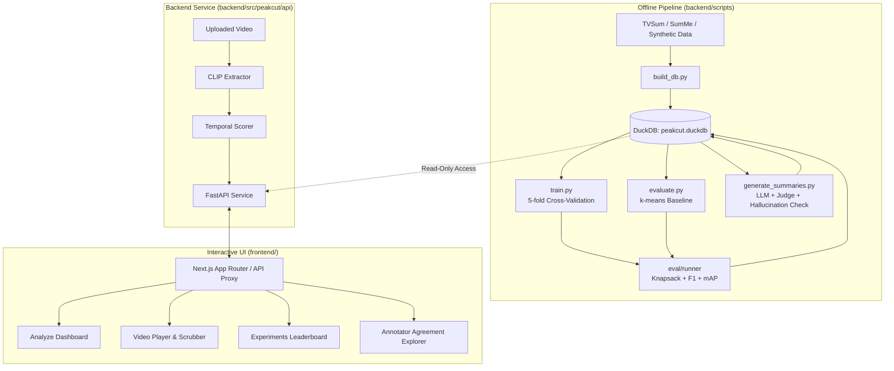
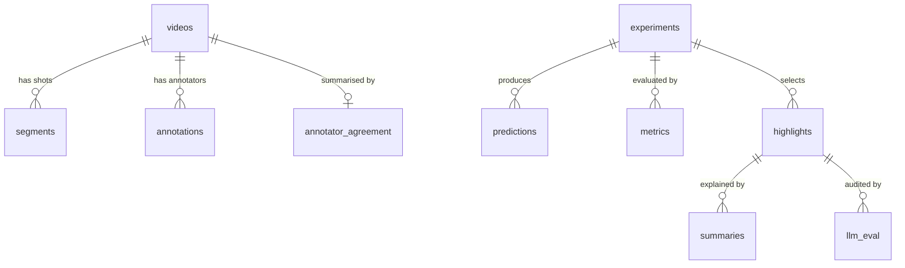

<div align="center">

# ✂️ Peakcut

**Find the best moments in a video, understand why annotators disagree about them, and explain each one in plain text.**

[](https://python.org)
[](https://nextjs.org)
[](https://www.typescriptlang.org)
[](https://fastapi.tiangolo.com)
[](https://duckdb.org)
[](https://pytorch.org)
[](https://github.com/google/jax)
[](https://tailwindcss.com)
[](https://pytest.org)

[Overview](#-overview) · [Architecture](#-architecture) · [Features](#-features) · [Tech Stack](#-tech-stack) · [Quick Start](#-quick-start) · [Project Structure](#-project-structure) · [Database](#-database) · [API Reference](#-api-reference) · [Method in Detail](#-method-in-detail) · [Testing](#-testing) · [Status](#-project-status-read-this)

</div>

---

## 📖 Overview

Peakcut is an end-to-end **video highlight detection and summarisation system**. Given any video, it:

1. **Extracts frame embeddings** using CLIP or bundled feature representations,
2. **Scores highlight-worthiness** across temporal sequences using a custom transformer,
3. **Selects optimal highlights** under a strict duration budget (default: 15% of total runtime) via 0/1 knapsack optimisation,
4. **Synthesises titles and concise summaries** for each highlight segment using an LLM, and
5. **Audits and validates** model outputs with automated judge rubrics, lexical hallucination checks, and inter-annotator agreement statistics.

### What makes Peakcut unique:

| Dimension | What Peakcut does |
|---|---|
| 🧑‍🤝‍🧑 **Annotators Disagree** | Quantifies inter-annotator agreement per video, isolates high-disagreement quartiles, and evaluates model resilience under label noise. |
| ⚖️ **Loss Comparison** | Trains the same architecture against **BCE** (with label smoothing), **Pairwise Ranking**, and **Listwise Contrastive (InfoNCE)** losses. |
| 🚫 **Label-Free Baseline** | Evaluates an unsupervised **k-means clustering baseline** through the identical knapsack evaluation pipeline. |
| 🧩 **Failure Analysis** | Breaks metrics down **per video category** (subgroup analysis) to expose semantic blind spots. |
| 🧪 **Verifiable LLM Layer** | Tests LLM output rather than trusting it: 3 prompt variants, an LLM-as-judge rubric, and an automated lexical hallucination checker. |
| 🔁 **Cross-Framework Parity** | Implemented in **PyTorch** and **JAX**, verified by strict weight-conversion parity unit tests. |
| 🗄️ **Everything Queryable** | Stores runs, predictions, segment boundaries, metrics, and summaries in **DuckDB**, ready for instant SQL analysis. |
| 💻 **Full-Stack Experience** | Complete system featuring a **FastAPI backend** and an interactive **Next.js web dashboard** (Analyze, Results, Experiments, Annotators). |

---

## 🏗 Architecture



### Core Design Rules

> [!IMPORTANT]
> **Single-Writer DB Concurrency**: The FastAPI service opens DuckDB in **read-only mode**. Offline scripts perform batch writes, ensuring DuckDB lock conflicts never occur during serving.

- **Storage Separation**: Heavy video files and raw embeddings remain on disk; the database holds only paths, frame indices, and metadata.
- **Traceable Experiments**: Every experiment run receives an immutable, unique `run_id`, allowing any benchmark metric, prediction curve, or summary to be audited and reproduced.

---

## ✨ Features

- **Multi-Dataset Ingestion**: Native loaders for TVSum and SumMe (KTS-style HDF5), plus a seeded **synthetic data generator** for testing without large downloads.
- **Dual Framework Architecture**: Complete PyTorch temporal transformer with an identical JAX/Optax port, featuring a parameter conversion parity check.
- **Loss Benchmarking Suite**: Binary Cross-Entropy with label smoothing, pairwise margin ranking, and listwise InfoNCE contrastive loss.
- **Knapsack Selection**: Dynamic programming 0/1 knapsack solver that selects the highest-scoring combination of shots within the 15% length constraint.
- **Robustness & Noise Mitigation**: Synthetic label noise injection alongside a confident-learning-style relabelling mechanism to recover noisy annotations.
- **Audited LLM Pipeline**: 3 prompt variants (`captions`, `captions+asr`, `few_shot`), an automated judge rubric (1–5 scale), and lexical hallucination detection.
- **Modern Interactive Web UI**: Built with Next.js 15, Tailwind CSS, and Radix UI primitives. Includes video scrubbing, score curve visualisation, leaderboard filtering, and annotator agreement inspection.
- **Production Engineering**: Strict Pydantic v2 schemas, layered YAML configuration, Dockerized deployment, Makefile automation, and a comprehensive pytest suite (60+ tests).

---

## 🧰 Tech Stack

| Layer | Technologies |
|---|---|
| **Frontend UI** | Next.js 15 (App Router), React 19, TypeScript, Tailwind CSS, Lucide Icons, Zustand |
| **Backend API** | FastAPI, Pydantic v2, Uvicorn, HTTP Range streaming |
| **Deep Learning** | PyTorch (primary), JAX + Optax (parity port) |
| **Feature Extraction** | CLIP (`transformers`), OpenCV, Pillow |
| **Classical ML & Stats**| scikit-learn (k-means baseline), SciPy, NumPy |
| **Embedded Database** | DuckDB, Apache Arrow / PyArrow, Pandas |
| **LLM & Evaluation** | Anthropic Claude API (optional), offline mock client, BLIP captioning |
| **DevOps & QA** | Docker, Makefile, pytest, ruff, GitHub Actions CI |

---

## 🚀 Quick Start

You can run Peakcut immediately without downloading massive datasets or requiring an expensive GPU.

### Option A: Launch the Web UI (Frontend)

The frontend includes Next.js route handlers mirroring the API contract, allowing you to explore the interface right away:

```bash
# Clone the repository
git clone https://github.com/SV-Gdev/peakcut.git
cd peakcut/frontend

# Install dependencies and start the dev server
npm install
npm run dev
```

Open [http://localhost:3000](http://localhost:3000) in your browser to interact with the full dashboard.

---

### Option B: Run the Python ML & API Pipeline (Backend)

```bash
cd peakcut/backend

# 1. Install dependencies (select the extras you need)
pip install -e ".[api,jax,dev]"        # Core + API + JAX + Testing
# pip install -e ".[train]"            # PyTorch training
# pip install -e ".[features]"         # CLIP video upload feature extraction
# pip install -e ".[llm]"              # Anthropic Claude client

# 2. Build the DuckDB database using synthetic data
make db

# 3. Run the unsupervised baseline and inspect the leaderboard
make baseline

# 4. Train with different loss objectives (requires [train] extra)
python scripts/train.py --loss bce
python scripts/train.py --loss ranking
python scripts/train.py --loss contrastive

# 5. Generate LLM summaries with judge & hallucination verification (mock client)
python scripts/generate_summaries.py --mock

# 6. Launch the FastAPI service -> http://localhost:8000/docs
make serve

# 7. Run the test suite
make test
```

### Using Real Datasets (TVSum & SumMe)

To train and evaluate on academic benchmarks:

```bash
# Place the dataset files into backend/data/raw/:
#   - tvsum.h5               (KTS/DSNet HDF5 format)
#   - summe.h5               (KTS/DSNet HDF5 format)
#   - ydata-tvsum50-info.tsv (optional: enables TVSum category subgroup analysis)

make data                    # Verifies dataset file presence
make db SOURCE=tvsum         # Or SOURCE=summe
```

### Generating LLM Summaries with Live APIs

```bash
export ANTHROPIC_API_KEY="your-api-key-here"
# Captions: backend/data/captions/<video_id>.json (list of frame captions)
python scripts/generate_summaries.py --variants captions few_shot
```

---

## 🗂 Project Structure

```
peakcut/
├── backend/                       # Python Backend, ML Pipeline & Database
│   ├── pyproject.toml             # Dependencies, extras, pytest & ruff configs
│   ├── Makefile                   # Automation: db, baseline, train, serve, test
│   ├── Dockerfile                 # Minimal inference & API container
│   ├── configs/                   # default.yaml, loss configs, api.yaml
│   ├── sql/                       # DuckDB DDL schema & analytical SQL queries
│   ├── scripts/                   # CLI scripts (build_db, train, evaluate, etc.)
│   ├── src/peakcut/               # Core package
│   │   ├── api/                   # FastAPI routes, schemas, services
│   │   ├── data/                  # Loaders for TVSum, SumMe, synthetic data
│   │   ├── db/                    # DuckDB connection pool & repository
│   │   ├── eval/                  # Knapsack solver, F1, mAP, subgroup metrics
│   │   ├── features/              # CLIP feature extraction & cache
│   │   ├── llm/                   # Prompts, judge rubric, hallucination check
│   │   ├── losses/                # BCE, Pairwise Ranking, InfoNCE Contrastive
│   │   ├── models/                # PyTorch transformer, JAX port, k-means
│   │   └── training/              # Trainer, 5-fold CV, noise mitigation
│   └── tests/                     # 60+ pytest unit & integration tests
│
├── frontend/                      # Interactive Next.js Web Application
│   ├── src/app/                   # App Router pages and API route handlers
│   │   └── api/peakcut/           # API routes matching FastAPI contract
│   ├── src/components/peakcut/    # Analyze, Result, Experiments, Annotators views
│   ├── src/components/ui/         # Radix UI + Tailwind design system
│   ├── src/lib/peakcut/           # API client, types, formatters, mock store
│   └── package.json               # Next.js 15, React 19, Tailwind CSS dependencies
│
└── overview.docx                  # Project documentation
```

<details>
<summary><b>📄 Detailed Backend Module Breakdown (click to expand)</b></summary>

### `backend/sql/`
| File | Purpose |
|---|---|
| `schema.sql` | DuckDB relational DDL defining all tables |
| `annotator_agreement.sql` | Computes pairwise Pearson correlation per video; flags the bottom agreement quartile |
| `per_category_metrics.sql` | Aggregates F1 / mAP by semantic video category |
| `noise_sensitivity.sql` | Performance degradation curves across injected noise levels |
| `leaderboard.sql` | Ranks all recorded runs by F1 and mAP |

### `backend/scripts/`
| Script | Purpose |
|---|---|
| `download_data.py` | Verifies presence of TVSum/SumMe files in `data/raw/` |
| `build_db.py` | Ingests synthetic data or HDF5 benchmarks into DuckDB and caches features |
| `extract_features.py` | Extracts CLIP frame embeddings for custom uploaded videos |
| `train.py` | Runs 5-fold cross-validated PyTorch training; records out-of-fold metrics |
| `evaluate.py` | Computes unsupervised k-means baseline scores and prints the leaderboard |
| `generate_summaries.py` | Runs LLM summary generation, judge scoring, and hallucination flagging |

### `backend/src/peakcut/`
| Subpackage | Key Files | Description |
|---|---|---|
| `api/` | `routes.py`, `schemas.py`, `services.py` | REST API endpoints, Pydantic DTOs, and video streaming service |
| `db/` | `connection.py`, `loader.py`, `repository.py` | Read-only connection management and centralised SQL query execution |
| `data/` | `tvsum.py`, `summe.py`, `synthetic.py` | HDF5 parsing, consensus computation, and synthetic noise generation |
| `models/` | `temporal_transformer.py`, `jax_transformer.py` | Hand-coded attention transformer in PyTorch and JAX with exact weight parity |
| `losses/` | `bce.py`, `ranking.py`, `contrastive.py` | Unified loss interfaces: classification, margin ranking, and listwise InfoNCE |
| `training/` | `trainer.py`, `noise.py` | K-fold cross-validation loop and confident-learning noise relabelling |
| `eval/` | `segments.py`, `metrics.py`, `runner.py` | 0/1 knapsack dynamic programming, F1 overlap calculation, and mAP |
| `llm/` | `prompts.py`, `generator.py`, `hallucination.py`| Prompt variations, LLM judge evaluation, and lexical hallucination auditing |

</details>

---

## 🗄 Database

Peakcut persists all experiment data in a single embedded DuckDB database file: `backend/data/db/peakcut.duckdb`.



| Table | Purpose |
|---|---|
| `videos` | Metadata per video: dataset, category, duration, fps, sample count, media paths |
| `segments` | Segment / shot boundaries (start and end sampled-frame indices) |
| `annotations` | Per-annotator, per-frame importance scores |
| `annotator_agreement` | Mean pairwise correlation and `high_disagreement` quartile flag |
| `experiments` | Experiment registry: model architecture, loss, noise level, seed, full config |
| `predictions` | Out-of-fold predicted frame importance scores |
| `metrics` | Evaluated F1 and mAP across `overall`, `category`, and `video` levels |
| `highlights` | Selected highlight segments under length budget |
| `summaries` | LLM-generated titles and summaries per highlight segment and prompt variant |
| `llm_eval` | Faithfulness score, informativeness score, and lexical hallucination flag |

> [!NOTE]
> Foreign keys are intentionally omitted: DuckDB prevents modifying parent rows with active child dependencies, which would prevent cleanly re-running experiments. Integrity is guaranteed via automated tests (`test_db.py`).

### Useful SQL Queries

```sql
-- 1. Identify videos with the highest annotator disagreement
SELECT video_id, mean_corr, high_disagreement 
FROM annotator_agreement 
ORDER BY mean_corr ASC 
LIMIT 10;

-- 2. Compare loss performance and noise resilience
SELECT experiment_id, loss_fn, label_noise, metric_value 
FROM metrics 
JOIN experiments USING (experiment_id) 
WHERE metric_name = 'f1_score' AND scope = 'overall' 
ORDER BY metric_value DESC;

-- 3. Hallucination frequency across LLM prompt variants
SELECT prompt_variant, 
       ROUND(AVG(CAST(hallucinated AS INT)) * 100, 2) AS hallucination_pct,
       ROUND(AVG(faithfulness_score), 2) AS avg_faithfulness
FROM llm_eval 
GROUP BY prompt_variant;
```

---

## 🔌 API Reference

Interactive Swagger documentation is available at `http://localhost:8000/docs` when running the backend.

| Method | Endpoint | Description |
|---|---|---|
| `GET` | `/health` | Service health check, database connectivity, and feature extractor status |
| `GET` | `/videos` | List all ingested videos with duration and dataset info |
| `GET` | `/videos/{video_id}` | Detailed metadata, agreement statistics, and annotator score curves |
| `GET` | `/media/{video_id}` | Video streaming endpoint supporting HTTP 206 partial range requests |
| `POST` | `/highlights` | Request highlights for a known video or upload a video for on-the-fly scoring |
| `POST` | `/summaries` | Retrieve LLM titles/summaries for specific highlight segment IDs |
| `GET` | `/experiments` | Fetch the full experiment leaderboard sorted by performance |
| `GET` | `/experiments/{run_id}/metrics` | Detailed overall and per-category metrics for a given experiment |

### Highlight Request Example

```bash
curl -X POST http://localhost:8000/highlights \
  -H "Content-Type: application/json" \
  -d '{"video_id": "synthetic_000"}'
```

```jsonc
{
  "video_id": "synthetic_000",
  "run_id": "kmeans_s42",
  "sample_rate": 2.0,
  "scores": [0.12, 0.18, 0.77, 0.85, ...],
  "highlights": [
    {
      "highlight_id": "kmeans_s42:synthetic_000:0",
      "start_sec": 15.0,
      "end_sec": 22.5,
      "start_idx": 30,
      "end_idx": 45,
      "score": 0.81
    }
  ]
}
```

---

## 🔬 Method in Detail

### 1. Data Representation & Consensus Labels
- Each video is stored as a `VideoRecord` containing frame embeddings $(T, D)$, annotator ratings $(U, T)$, shot boundaries $(S, 2)$, and duration.
- **Consensus Score**: Computed as the mean of min-max normalised scores across all human annotators.
- **Binary Highlight Labels**: Top 15% of frames ranked by consensus (`label_positive_ratio = 0.15`).

### 2. Temporal Transformer Architecture
- Input frame embeddings are linearly projected into $d_{\text{model}}$ dimensions, enriched with sinusoidal positional encodings, and processed through pre-norm transformer blocks with explicit multi-head self-attention and causal padding masks.
- Implemented with identical architectures in PyTorch and JAX to guarantee parameter conversion parity.

### 3. Loss Functions
All loss implementations share a standard signature `loss(logits, labels, mask)`:
- **Binary Cross-Entropy (BCE)**: Frame-level classification with optional label smoothing.
- **Pairwise Ranking**: Enforces a margin $m$ between highlight and non-highlight frames:
  $$\mathcal{L}_{\text{rank}} = \frac{1}{|P||N|} \sum_{i \in P} \sum_{j \in N} \max(0, m - (s_i - s_j))$$
- **Listwise Contrastive (InfoNCE)**: Treats highlight frames as queries and contrasts them against all non-highlight frames in the video at temperature $\tau$.

### 4. Summary Selection via 0/1 Knapsack
- Highlight selection groups frames into segments (either dataset shot boundaries or 5-second uniform chunks).
- Each segment receives an importance value equal to its mean normalised predicted score.
- A dynamic programming 0/1 knapsack algorithm selects the combination of segments that maximises total score while strictly respecting the 15% total video duration budget.

### 5. Robustness & Confident Learning
- **Noise Injection**: Controllable label noise flips an exact proportion of training labels while preserving clean validation ground-truth.
- **Mitigation**: A custom confident-learning relabeller identifies and corrects label noise based on out-of-fold predicted class probabilities.

### 6. LLM Summaries & Verification
- **Generation**: Three prompt strategies (`captions`, `captions+asr`, `few_shot`).
- **LLM Judge**: Evaluates generated text on a 1–5 scale for **faithfulness** (factual alignment with captions) and **informativeness** (contextual value).
- **Lexical Hallucination Check**: Automatically extracts non-stopword content words from generated summaries and verifies their presence in the source frame captions.

---

## 🧪 Testing

The repository includes a comprehensive test suite covering mathematical correctness, database integrity, framework parity, and API behaviour.

```bash
# Run backend tests
cd backend && make test

# Run linter
cd backend && make lint

# Run frontend linting
cd frontend && npm run lint
```

| Test Area | What is Verified |
|---|---|
| **Metrics** | F1 and average precision match analytical ground truth |
| **Knapsack** | Dynamic programming output matches exhaustive brute force; budget strictly held |
| **Losses** | PyTorch and JAX losses match NumPy reference implementations within $1e-5$ |
| **Parity** | PyTorch weights convert to JAX; both produce identical forward-pass logits |
| **Agreement** | SQL-calculated annotator agreement matches vectorized NumPy calculations |
| **Database** | Idempotent loads, cascade replacement on re-runs, zero orphan rows, read-only enforcement |
| **API** | Status codes, error handling (404, 413, 422, 501), upload pipeline, range streaming |

---

## 🐳 Docker Deployment

A lightweight Dockerfile is provided for running the backend API in containerised environments:

```bash
# Build the backend image
docker build -t peakcut-backend backend/

# Run the container (mounting data directory)
docker run -p 8000:8000 -v "$PWD/backend/data:/app/data" peakcut-backend
```

---

## ✅ Project Status (Read This)

### Verified Components:
- DuckDB schema, data loader, query repository, and analytical SQL queries.
- Knapsack dynamic programming solver and evaluation metric suite (F1, mAP).
- JAX model implementation, padding invariance, and loss convergence.
- LLM pipeline with mock clients, judge rubrics, and lexical hallucination flags.
- Complete FastAPI backend and interactive Next.js 15 web application.

### Hardware-Dependent Real-Data Execution:
- PyTorch training and evaluation on full TVSum/SumMe datasets requires raw HDF5 files.
- CLIP feature extraction and live Anthropic API calls require local GPUs / valid API keys.

### Benchmark Results Table

| Experiment Run | Framework | Loss Function | Label Noise | F1 Score | mAP |
|---|---|---|---|---|---|
| `kmeans_s42` | Scikit-Learn | Unsupervised | 0.0 | _tbd_ | _tbd_ |
| `pytorch_bce_n0.0_s42` | PyTorch | BCE | 0.0 | _tbd_ | _tbd_ |
| `pytorch_ranking_n0.0_s42` | PyTorch | Ranking | 0.0 | _tbd_ | _tbd_ |
| `pytorch_contrastive_n0.0_s42` | PyTorch | Contrastive | 0.0 | _tbd_ | _tbd_ |

---

## 🛣 Roadmap

- [x] Full-Stack interactive web dashboard (Analyze, Result, Experiments, Annotators)
- [x] Dual framework implementation (PyTorch + JAX) with parameter parity
- [x] Multiple loss formulations (BCE, Pairwise Ranking, InfoNCE)
- [x] DuckDB analytical data warehouse and reproducible experiment tracking
- [ ] PyTorch training benchmark runs on real TVSum / SumMe datasets
- [ ] Calibrate LLM-as-judge rubric against human-curated highlight descriptions
- [ ] Native shot boundary detection for arbitrary user-uploaded videos
- [ ] Whisper-based ASR transcription integration for the `captions+asr` prompt variant

---

## 📚 References & Datasets

- **TVSum**: Song et al., *TVSum: Summarizing Web Videos Using Titles*, CVPR 2015.
- **SumMe**: Gygli et al., *Creating Summaries from User Videos*, ECCV 2014.

---

## 📄 License

This project is licensed under the [MIT License](LICENSE).

---

<div align="center">
Built for video highlight experiments you can <b>reproduce</b>, <b>query</b>, and <b>defend</b>. 🎯
</div>
